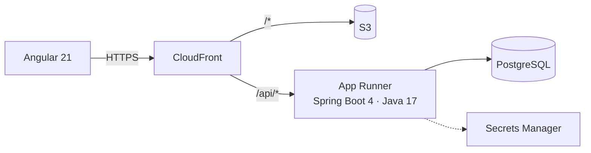

# transfers-core

[](https://github.com/ferwinred/transfers-core/actions/workflows/ci.yml)
[](https://github.com/ferwinred/transfers-core/actions/workflows/codeql.yml)


API **transaccional** de transferencias entre cuentas, con un front en Angular, pensada como lo haría un core bancario:

- **Idempotencia:** un reintento por falla de red **no cobra dos veces** (`Idempotency-Key`).
- **Concurrencia segura:** bloqueo pesimista en orden fijo. Con 20 retiros simultáneos no se gasta dos veces el mismo dinero ni hay deadlocks.
- **Libro contable de doble partida:** cada transferencia genera un débito y un crédito que suman cero.
- **Código seguro** (OWASP API Top 10): JWT con scopes, protección contra BOLA, validación por allow-list, errores RFC 9457 sin detalles internos, cabeceras de seguridad, CodeQL y **cero secretos en el repositorio**.
- **DevOps en AWS:** Docker, CI en GitHub Actions, despliegue con OIDC a App Runner + RDS + S3/CloudFront con Terraform.

> Proyecto personal de portafolio con **datos ficticios**. Construido con asistencia de IA, revisado y probado; el proceso está en [docs/uso-de-ia.md](docs/uso-de-ia.md).

## Arquitectura



Detalle, modelo entidad-relación, diagrama de secuencia y decisiones técnicas: [docs/arquitectura.md](docs/arquitectura.md). Controles de seguridad: [docs/seguridad.md](docs/seguridad.md).

## API

| Método | Ruta | Permiso | Descripción |
|---|---|---|---|
| `POST` | `/api/v1/transfers` | `transfers:write` | Crea una transferencia. Header `Idempotency-Key` obligatorio. `201`, o `200` + `Idempotent-Replayed: true` si es un reintento |
| `GET` | `/api/v1/accounts` | `accounts:read` | Cuentas del usuario autenticado |
| `GET` | `/api/v1/accounts/{n}/movements` | `accounts:read` | Movimientos (libro contable) de una cuenta propia |
| `POST` | `/api/v1/auth/demo-token` | — | Token de prueba (**solo perfil `demo`**) |

Errores (`application/problem+json`): `400` formato inválido · `401` sin token · `403` sin permiso · `404` cuenta inexistente o ajena · `409` llave reutilizada con otra orden · `422` regla de negocio (`INSUFFICIENT_FUNDS`, `DAILY_LIMIT_EXCEEDED`, `ACCOUNT_INACTIVE`, …).

Documentación interactiva (perfil demo): `http://localhost:8080/swagger-ui.html`

## Cómo correrlo

**Todo con Docker** (PostgreSQL + API + front):

```bash
cp .env.example .env     # define tu DB_PASSWORD local (el archivo .env no se versiona)
docker compose up --build
# http://localhost:8081  → entrar como ana, carlos o laura
```

**En desarrollo:**

```bash
./mvnw spring-boot:run -Dspring-boot.run.profiles=demo   # API con H2 en memoria y datos de ejemplo
cd web && npm ci && npx ng serve                          # http://localhost:4200 (proxy a la API)
```

**Pruebas:**

```bash
./mvnw verify   # 30 pruebas (unitarias, integración, seguridad y concurrencia) + umbral de cobertura del 80 %
```

## Despliegue en AWS

La infraestructura está en [`infra/terraform`](infra/terraform) (validada con `terraform validate`; genera costos: destruir al terminar).

1. `terraform apply -target=aws_iam_role_policy.deploy_ecr` (crea ECR, el proveedor OIDC y el rol con permiso de subir imágenes).
2. En GitHub, secreto `AWS_DEPLOY_ROLE_ARN` = `terraform output deploy_role_arn`. Subir la primera imagen a ECR (el paso "API → ECR" del workflow, o `docker push` manual).
3. `terraform apply` (crea App Runner, RDS, S3 y CloudFront). Luego, variables de GitHub `WEB_BUCKET` y `CLOUDFRONT_ID` desde `terraform output`.
4. Desde ahí, cada ejecución del workflow **Deploy a AWS** publica la API y el front.
5. `terraform destroy` al terminar.

## Estructura

```
src/main/java/com/ferwin/transfers
├── account/    entidad Cuenta, repositorio con SELECT FOR UPDATE
├── transfer/   servicio (idempotencia) y ejecutor transaccional (reglas, bloqueo, doble partida)
├── ledger/     asientos contables
├── security/   JWT, scopes, CORS, cabeceras, emisor de demo
├── web/        controladores, DTOs validados, errores RFC 9457, correlation id
└── common/     excepciones y enmascaramiento
src/main/resources/db/migration   esquema versionado con Flyway
web/                              front en Angular 21 (signals, formularios reactivos)
infra/terraform/                  AWS: ECR, App Runner, RDS, Secrets Manager, S3, CloudFront, OIDC
docs/                             arquitectura, seguridad, uso de IA
GUIA.md                           guía para entender y explicar el proyecto
```

## Autor

**Edwin Fernando Arias Arrieta** · Medellín, Colombia · [ferwinred.github.io](https://ferwinred.github.io) · [LinkedIn](https://www.linkedin.com/in/ferwinarias)
