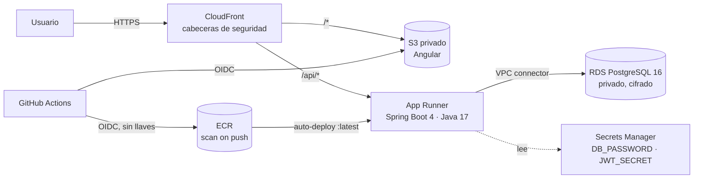
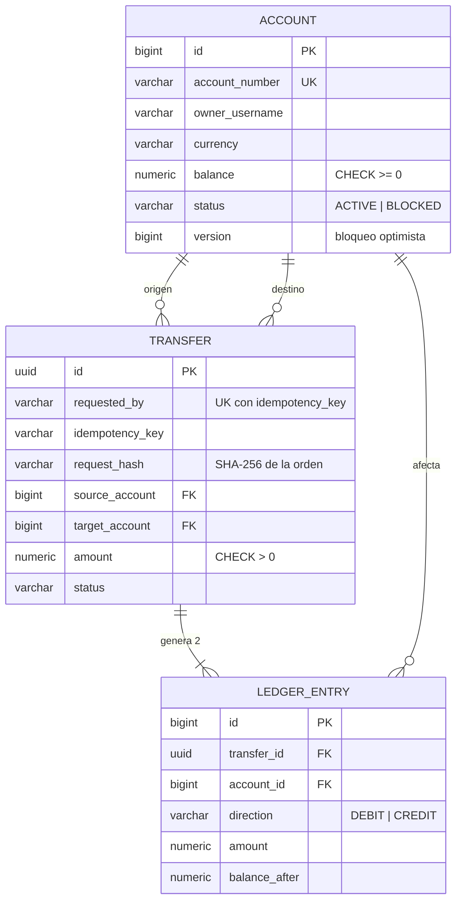
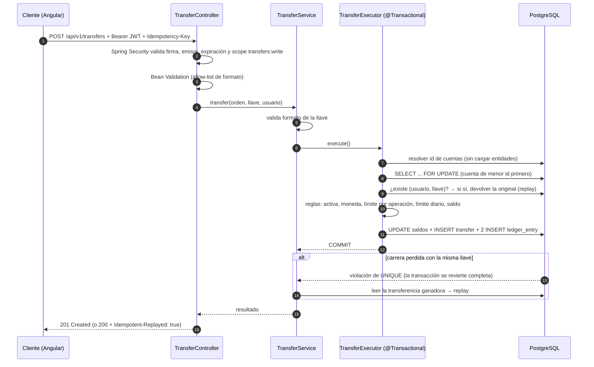

# Arquitectura y diseño

## Componentes en AWS

## Modelo entidad-relación

## Secuencia de una transferencia

## Decisiones técnicas (ADR resumidos)

| # | Decisión | Alternativas | Por qué |
|---|---|---|---|
| 1 | **Idempotency-Key por usuario** + hash SHA-256 de la orden | Deduplicar por contenido; sin idempotencia | Los reintentos de red son inevitables en pagos móviles. La llave distingue "reintento" de "segunda transferencia igual a propósito"; el hash detecta que se reutilizó la llave con otra orden (409). |
| 2 | **Bloqueo pesimista** (`SELECT FOR UPDATE`) en orden de id | Solo bloqueo optimista con reintentos; `UPDATE ... WHERE balance >= x` | Con alta contención sobre la misma cuenta, el optimista genera muchos reintentos. El orden fijo de bloqueo evita deadlocks en transferencias cruzadas (probado con 20 hilos). `@Version` queda como segunda defensa. |
| 3 | **Libro de doble partida** inmutable | Solo actualizar el saldo | Auditoría: el saldo se puede reconstruir y la suma de asientos de cada transferencia es 0. Es el estándar contable. |
| 4 | Resolver cuentas por **proyección** antes de bloquear | Cargar la entidad y luego bloquear | Cargar la entidad sin bloqueo deja en memoria una versión que puede envejecer; el test de concurrencia lo detectó (`StaleObjectStateException`). |
| 5 | **`BigDecimal` y `NUMERIC(19,2)`** | `double` | El punto flotante no representa exactamente valores monetarios. |
| 6 | **Restricciones en la base** (`CHECK balance >= 0`, `UNIQUE`, FK) además del código | Solo validar en Java | Defensa en profundidad: aunque haya un bug en la aplicación, la base no acepta un saldo negativo ni un duplicado. |
| 7 | **JWT validado localmente** (firma HS256, emisor, expiración, scopes) | Sesiones con cookie | API sin estado que escala horizontalmente. En un banco el emisor sería un IdP (Cognito/Entra ID/Keycloak) con RS256 y JWKS; aquí el emisor de demo solo existe en el perfil `demo`. |
| 8 | **Mismo origen** con CloudFront (`/api/*` → App Runner) | CORS abierto | Menos superficie de ataque: no hace falta permitir orígenes cruzados en producción. |
| 9 | **App Runner** | ECS Fargate + ALB; EKS; Lambda | Menos piezas que operar para una API; TLS y autoescalado incluidos. Para varios servicios o necesidades de red avanzadas pasaría a ECS/EKS. |
